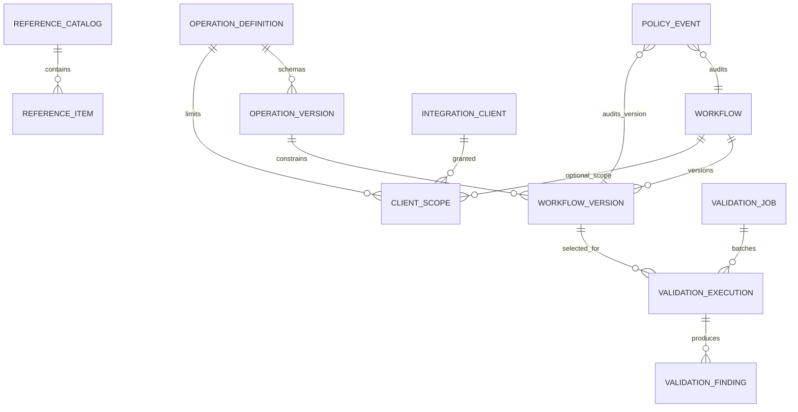
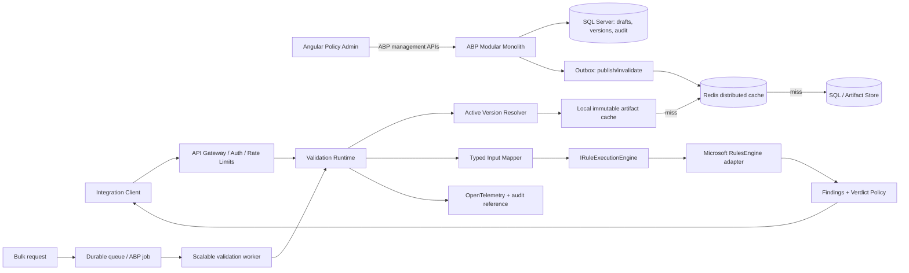

# Integration Validation and Dynamic Rules Platform

**Status:** Architecture proposal, grounded in legacy business discovery  
**Discovery source:** `D:\Work\Ree` (read-only inspection)  
**Prepared:** 5 October 2026

## Executive summary

The legacy system is an Egyptian healthcare claims and medical activity validation application. It evaluates claim-level and activity-level conditions using configurable rule records plus a collection of specialized rule flags. A workflow is a named bundle/configuration of rule capabilities; it is not a demonstrated sequence of business steps. Rules return multiple failures, and the persisted result distinguishes rejection as a boolean and carries a free-form `ErrorType`. The inspected system does not establish a Warning/Soft/Hard/Critical severity hierarchy, priority-based winner, or rule/workflow publication lifecycle.

The new platform should preserve the business capability—evaluate versioned, configurable validations for an integration request and explain every outcome—without importing the legacy model. Use a .NET 10 / ABP 10 modular monolith, EF Core 10 and SQL Server, Angular 22, and Microsoft RulesEngine behind an execution adapter. Keep a typed structured rule definition as the authoritative, immutable versioned business artifact. Validate and compile it at publication; store a content-addressed compiler artifact for fast loading and diagnostics. Treat results as a set of findings; use an explicitly governed rejection policy only if business owners decide that findings need aggregation into a verdict/severity.

The current official release information checked for this proposal reports .NET 10 as supported LTS through November 2028, ABP 10.6 as the latest stable release (July 2026), ABP 10.6 Angular UI upgraded to Angular 22, and Angular 22 as actively supported. Pin exact package patches from the ABP compatibility matrix and lockfiles at implementation start; “latest” is a moving target. [Microsoft .NET support](https://learn.microsoft.com/en-us/dotnet/core/releases-and-support), [ABP release notes](https://abp.io/docs/latest/release-info/release-notes?LanguageCode=en), [Angular supported versions](https://angular.dev/reference/versions).

---

# PHASE 1 — BUSINESS DISCOVERY FROM D:\Work\Ree

## 1. Scope and evidence

Inspected the backend solution, domain and shared models, application services/contracts, EF Core migration/model snapshot, rule processing and execution paths, integration validation endpoints, and the Angular workflow/rule forms and related generated API models. Relevant evidence includes:

- `D:\Work\Ree\emrbackend\src\EhealthClaims.Domain\Model\Claims\WorkFlow.cs`
- `D:\Work\Ree\emrbackend\src\EhealthClaims.Domain\Model\Rules\Rule.cs`
- `D:\Work\Ree\emrbackend\src\EhealthClaims.Application.Contracts\Domains\Rules\RuleDto.cs`
- `D:\Work\Ree\emrbackend\src\EhealthClaims.Application.Contracts\Domains\Rules\RuleExpressionBuilder.cs`
- `D:\Work\Ree\emrbackend\src\EhealthClaims.Domain\Repositories\EnitityCach\RulesEngineManager.cs`
- `D:\Work\Ree\emrbackend\src\EhealthClaims.EntityFrameworkCore\Repositories\Claims\ClaimValidationResultAppRepository.cs`
- `D:\Work\Ree\emrbackend\src\EhealthClaims.Application\Domains\Claims\ClaimValidationAppService.cs`
- `D:\Work\Ree\emrfrontend\src\app\pages\workflow\components\workflowform\workflowform.html`
- `D:\Work\Ree\emrfrontend\src\app\pages\rules\components\rule-form\rule-form.html`

The application contains many unrelated claims-administration capabilities. This document only carries forward the integration validation and dynamic-rules business. Evidence distinguishes what is directly implemented from what cannot be established from code. In particular, the requested “rejection level” language is not the same thing as the legacy `ErrorType` or the separate claim/activity/audit rejection-tag category.

## 2. Business at a glance

**Observed business:** validate claims and their medical activities against configured medical, demographic, quantity, date, amount, coding, and data-quality checks. Input values include activities, diagnosis codes, claim identifiers and amounts, batch type/month/year, dates, national ID, patient age/gender, quantities and tags. Administrators choose workflows and manage rules; callers submit claims for one or more workflows; the system reports each failed rule. Batch validation can run asynchronously and report progress.

**Business requirement inferred:** external health/claims systems need a repeatable way to ask whether a claim payload conforms to configured validation policy. An individual failed rule is explainable and can be associated with an error category/message. This is a reasonable clean requirement, but the exact business meaning of `ErrorType`, when a failure blocks payment/processing, and whether a distinction like warning vs rejection is needed require business-owner confirmation during discovery workshops.

### 2.1 Concepts

| Concept | Meaning and purpose | Attributes and relationships evidenced | Lifecycle / rules | Example / confidence |
|---|---|---|---|---|
| Workflow | Named set of validation rules, with capability switches that influence rule creation and context. It groups related claim validation behavior. | Name, timestamps, creator/modifier, deletion marker, many Rules, many boolean `Is…` settings. | Create, edit, delete, list/view. No explicit draft/publish/activate/version found. | “Wrong Entered Net” may be an independent claim-level workflow. High confidence. |
| Rule | A configured predicate evaluated by Microsoft RulesEngine; failure emits a rule name and message/type. | Rule name, enabled, `Expression`, `RuleExpressionType`, `SuccessEvent`, `ErrorMessage`, `ErrorType`, WorkflowId; optional activity types, medication/diagnosis links, quantity, age, amount fields and flags. | Create/edit/delete; enable/disable; imported rules. No immutable version history found. | “Activity quantity by age range”. High confidence. |
| Rule family/type | A named validation capability represented largely by workflow/rule boolean flags and handwritten compiler branches. | Flags such as `IsDrugToDiagnosis`, `IsActivityWithSpecificActivity`, `IsOutlierUnitPrice`, `IsInvalidClaimStartDate`. | Supported forms are conditional in Angular and expression-generation code. | Catalog below. High confidence for found flags, semantics sometimes require domain confirmation. |
| Activity / medical activity | A healthcare service/procedure/drug/consumable billed within a claim. The legacy word “medication” is also used in code for activity-code collections. | Activity subtype/code/description, quantity, gross/net/patient share, dates, provider/physician, claim; separate reference entities for medical activity/type/subtype. | Reference data is managed/imported; individual claimed activities are part of a claim. Source system and tenant ownership are not shown consistently. | Code lists feed rule matching. High confidence. |
| Activity type / subtype | Categorization/reference value used to narrow activity choices in rule forms. | ID and description/status in `ActivityType`; the richer medical-activity subtype model has code/description and validity/reference attributes. | Active flag exists; activity/subtype catalogue may come from integration/import. Exact ownership not established. | Rule form selects type then one or more activity codes. High confidence. |
| Diagnosis | Clinical diagnosis code attached to a claim and selected into rules. | Code, description/name, IDs; diagnosis counts are passed into evaluation. | Reference data plus claim-level occurrences. | Rule can constrain a set of diagnosis codes or their quantity. High confidence. |
| Operation configuration | **No independent Operation entity/configuration was found.** The closest concept is a workflow’s capability flags and rule-specific optional `ActivityTypeId` / `SecondaryActivityTypeId`. | Activity/diagnosis operand families, two activity type slots for some rule forms. No generic source/target/operand metadata model. | No standalone lifecycle or generic operation catalog found. | Do not assume the proposed Activity→Activity abstraction already exists. High confidence. |
| “Primary/secondary activity” | Angular labels two selections “Primary Activity” and “Secondary Activity” for pair-based rule forms. | Each side selects an activity type and a list of activities. | For `IsActivityWithSpecificActivity`, expression logic checks same-presence of either set: both occur or neither occurs passes; one without the other fails. This is co-occurrence/paired-set behavior, not chronology. Another activity-pair family checks forbidden co-presence. | There is no evidence of previous/next, before/after, parent/child or sequence order. High confidence on the inspected pair logic. |
| Rejection reason/tag | A rejection classification attached to claim/activity/audit contexts. | Lookup has code, description and `LevelType`; `Tagtype` is `Claim=1`, `Activity=2`, `Audit=3`; many-to-many-like claim/activity links. | Used to label rejection reasons in claim domain; no rule-to-severity mapping observed. | This “level” is a rejection target/category, not an evidenced severity scale. High confidence. |
| Rule `ErrorType` | Free-form failure category stored on Rule and copied to validation result. | String; UI dropdown uses `name`/`code`; the specific choices were not located in inspected evidence. | Resolved on failure and returned with the finding. | Do not equate with severity until product owner defines it. High confidence. |
| Validation request | Claim payload plus requested workflow IDs/names. | Patient NID/age/gender, diagnosis and activity code/ID lists, counts/quantities, claim totals, dates, batch type/service period, claim tags. | Synchronous integration validation and batch processing exist. | JSON by-code integration payload. High confidence. |
| Validation result/finding | One failed rule occurrence associated with a claim/workflow and sometimes activity. | `Rejection` boolean, workflow name, rule name, error message/type, claim/patient/batch/job identifiers; DTO includes activity and claim number. | Can be returned immediately or persisted for batch jobs; all failures are collected in inspected paths. | “No Violation Found!” when no failures. High confidence. |
| Validation job | Background execution state for batch validation. | Job ID, batch ID/code, workflow IDs, status, total/processed claims, inserted results, timestamps/error. | InProgress/Failed/etc; polling endpoint returns paged jobs. | Used for batch jobs, not an operation configuration. High confidence. |
| Operator / comparison | A comparator chosen for quantity or age in supported forms. | Literal strings `==`, `>`, `<`, `>=`, `<=` in Angular controls and expression generation. | Backend performs specialized generation; no central operator registry found. | Quantity and age comparisons. High confidence. |
| Workflow/rule version | Versioned immutable publication artifact. | No version number, draft/published state, activation event or history was found. | Not an observed legacy business capability. | Recommended future capability, not discovery. |

### 2.2 Actual rule families found

The implementation’s authoritative behavior is distributed across the rule DTO, expression builder, import processor, Angular form conditions, and claim evaluator. Flags found include:

| Existing capability | Inputs | Condition/result behavior visible in code | Caveat |
|---|---|---|---|
| Activity-to-activity incompatibility / pairing | Two activity code groups | One family rejects when both groups occur; specific-activity family is satisfied when both groups occur or both are absent, thereby flagging asymmetric presence. | Pair logic differs by flag; not a temporal sequence. |
| Diagnosis-to-diagnosis relationship | Two diagnosis groups | Pair/presence relationship; some form paths combine with quantity. | Exact clinical semantics should be validated with rule owners. |
| Activity-to-diagnosis / activity with specific diagnosis | Activity and diagnosis code sets | Reject/require a match between selected sets; matching may mean a prohibited or required combination depending on flag. | Business language is not uniform. |
| Activity/diagnosis quantity | Codes, count, comparator, quantity | Counts of matching codes checked with a comparator; age/overdose variants exist. | Legacy code sometimes uses “all codes” vs “any code” behavior. |
| Daily dose / overdose | Activity, quantity, age, gender | Quantity plus optional age/gender constraints; helper function evaluates counts. | Dose units, periods and clinical meaning need clinical policy sign-off. |
| Activity quantity by patient age range | Activity codes, min/max age, quantity/comparator | Compares activity quantity within an age interval. | A dedicated predicate rather than a generic condition form. |
| Activity/diagnosis age restriction | Code set, age and comparator/value | Rejects matching use for an age condition. | Workflow flags select form. |
| Activity/diagnosis gender restriction | Code set, patient gender | Rejects matching use for a gender condition. | Legacy supported values shown as Male/Female. |
| Wrong entered net / gross | Claimed amount, entered amount, tolerance (defaults to 1 EGP) | Failure when absolute difference exceeds tolerance. | Amount semantics/currency should be explicit in new model. |
| Incorrect NID placeholder | NID | Flags fixed placeholder `10000000000000`. | This specific value is legacy policy data. |
| Invalid claim start/end date | Claim date, batch service month/year, batch type | OP/ER start date and IP end date must fall in service month/year. | Rule DSL should model date/month comparisons explicitly. |
| Accommodation days vs LOS | IP claim dates, matching accommodation codes and quantities | Compares matching quantities with date difference in days. | Inclusive/exclusive LOS behavior needs confirmation. |
| General diagnosis | Diagnosis codes | Rejects selected/general ICD code family. | ICD list is embedded in legacy code. |
| Wrong ICD for physiotherapy | Physiotherapy activity and diagnosis sets, OP batch | Checks an embedded activity-code list against accepted diagnosis list. | Large clinical lists belong in governed reference/rule data. |
| Missing tag for invalid codes | Activity descriptions, activity/claim tags | Invalid activity descriptions require a tag on activity or claim. | Descriptions are hard-coded. |
| Missing price tag | Activity tags and amount fields | A “Missing Prices” tagged activity must have zero gross/net/patient share. | Tag spelling varies across code. |
| Outlier unit price | IP, gross, quantity, min/max unit price, exemption tags | Unit price outside stored min/max bounds is flagged unless miscalculation/missing-price tags exempt it. | Percentiles are precomputed inputs; source/time window rules are external. |
| Activity to specialty | Activity/diagnosis and clinician specialty | Produces an inconsistency message. | Specific expression inputs need deeper clinical review. |

**Not found:** user-authored generic logical condition trees; generic `Equals`/`Contains`/`In` operator catalog; `StartsWith`/`EndsWith`/null operators; generic rule actions; per-rule priority/severity ordering; an operation entity; a dynamic operand/field catalog; temporal activity sequencing; workflow/rule versioning and publication. These may be future requirements, not discovered features.

## 3. Actors (observed and inferred)

The code provides ABP users/roles and permissions, rule/workflow management screens, API permissions, and integration endpoints. It does not define a clean business actor taxonomy. The following are role concepts for the new product, inferred from these functions:

| Actor | Responsibilities | Create/edit/publish/execute/view |
|---|---|---|
| Platform administrator | Configure identity, clients, global settings, tenant setup if enabled. | Manage security/platform configuration; no business rule authoring implied. View operational status. |
| Rule/workflow designer | Maintain validation catalog and construct rule drafts. | Create/edit drafts, validate and simulate; cannot publish unless granted publisher permission. View own/team drafts and published configuration. |
| Rule publisher / policy approver | Review clinical/business change, approve and publish immutable versions. | Publish, activate, schedule and roll back to a prior version subject to approval policy; cannot silently rewrite published versions. |
| Reference data steward | Maintain or reconcile activities, diagnoses and external code mappings. | Create/import/update reference data and effective dates; cannot publish rules unless separately authorized. |
| Integration client/system | Submit validation requests. | Execute only operations and tenants/scopes allowed to its client credentials; view its own response/request ID. No management permissions. |
| Support/operations user | Investigate jobs, failures, latency and configuration versions. | View sanitized request diagnostics, status, outcome and audit history; no rule changes by default. |
| Auditor/compliance reviewer | Review configuration and execution evidence. | Read immutable audit and version history; cannot alter or execute policy. |

## 4. Legacy use cases

Each item below records observed behavior or identifies the inferred actor. “Publish” is deliberately absent from observed legacy use cases.

| Use case | Actor; preconditions | Steps and business rules | Expected result | Failure cases |
|---|---|---|---|---|
| Create workflow | Rule administrator; authorized user; unique name. | Submit name and selected validation-capability flags; persist workflow. Name is checked for duplicates. | Workflow appears in management list and can own rules. | Duplicate name; validation/database error; authorization gaps in current create method. |
| Edit workflow | Rule administrator; workflow exists. | Change name/flags; duplicate names disallowed. | Updated configuration. | Missing workflow, duplicate name, stale overwrite, unauthorized request. |
| Delete workflow | Rule administrator; workflow exists. | Delete by ID. | Removed/soft-deleted workflow per repository behavior. | Rules may be orphaned or constrained; not resolved from service contract alone. |
| View/list workflows | Rule admin/designer; page parameters. | Retrieve workflow, paged list and rule counts. | Workflow configuration shown. | Not found, permission inconsistency (some view authorization is commented out). |
| Create/edit rule | Rule designer; workflow exists; reference codes resolve. | Select workflow; enter name, enabled, error message/type; fill fields made visible by workflow flags; backend builds expression and stores it. | Rule becomes executable within workflow. | Invalid/missing inputs, unresolvable IDs, malformed expression, duplicate naming or DB failure. |
| Delete rule | Rule administrator; rule exists. | Delete rule by ID. | Rule is removed and engine is reloaded/updated through processing path. | Not found, stale engine, authorization. |
| Import rules | Rule admin; workbook/batch and workflow exist. | Upload spreadsheet, parse rows, populate special fields/expressions, queue/import with processing/logging. | Rules are inserted/updated and import status/results can be inspected. | Invalid workbook/row, reference data missing, expression failure, partial batch failure. |
| Download import template | Rule designer; workflow selected or query context available. | Generate columns based on workflow flags. | Workbook guides required fields. | Invalid workflow or export error. |
| Execute selected validation | Integration client or authorized admin; well-formed claim; selected workflow IDs/names. | Resolve code IDs to code values where needed; assemble ctx; execute rules; collect every failed rule. | Success marker if none, otherwise list of failures. | Missing workflow/request, invalid JSON, bad IDs/codes, engine error, infrastructure error. |
| Validate batch | Claims operator; selected batches and optional workflows. | Create job record; run background batch task; persist progress/results; poll jobs. | Job status and validation findings. | Empty batch list; job execution failure; process restart/lost task; partial results. |
| View validation result/job | Support, claims operations; authorized request/job. | Query persisted findings or paged job status. | See rule/workflow/error type/message, claim/activity and processing status. | Result retention/access issue; sensitive data exposure; incomplete job. |

## 5. Important discovery answers

### Workflow meaning

**Observed business meaning:** named rule container plus controls describing which rule templates/fields are available. It can contain multiple enabled/disabled rules. It is selected by name or ID for evaluation. It is not demonstrated to orchestrate sequential activities or services.

**Not evidenced:** ownership/team, multi-tenant scoping, active workflow selection rule, workflow/rule versions, effective dates, approval/publication, rollback, or whether duplicate rule names are disallowed across a workflow. The engine manager loads persisted named workflows containing rules. Therefore the legacy system appears to execute the current database snapshot and does not provide immutable version selection.

### Rejection behavior

**Observed:** failed RulesEngine results are collected, and some result paths set `Rejection = true`; other immediate responses return failed-rule details. Batch and selected validation can include several failures. The code does not reduce outcomes to the highest severity or stop on a failure in the inspected `ExecuteAllRulesAsync` paths. `ErrorType` is arbitrary text and a separate rejection-reason lookup uses `LevelType` to classify Claim/Activity/Audit.

**Conclusion:** no Warning/Soft/Hard/Critical ladder or “highest wins” policy can be claimed from source. Preserve all findings. Model optional severity as future governed metadata, with a documented aggregation function and fail-open/fail-closed behavior only after owners define it.

### Activity pair semantics

**Observed:** form supports a primary and secondary list under a specific-activity scenario and there is another activity-to-activity switch. The specific-activity generated expression tests co-occurrence symmetry. The current evidence does not imply chronology. Thus “Primary” and “Secondary” appear to be operand labels/sets, not source and destination events. Recommended new terms are `Operand A` / `Operand B` or semantic aliases declared by metadata. A `Sequence` relation should be a distinct future operator with explicit ordering/time inputs.

### Activity/reference data

The legacy “Activity” name spans at least (1) billed claim line items, (2) medical activity codes/subtypes and descriptions, and (3) activity type categories. Codes and descriptions drive rules, and data is accessed through lookup/reference services. Some activity attributes include status, validity, prices, rejection reasons, tags, and source-shaped fields, but a stable external identifier/source-system/tenant/effective-date contract is not universal in the inspected legacy rule model. For the new design, keep `Reference Item`/`Operand Type` generic in the platform, and define the healthcare activity catalog as a separate domain adapter/reference-data set.

## 6. Business requirements (clean-room)

1. A client submits a typed business payload for a named operation; authorization binds it to the correct tenant/client and operation scope.
2. Each operation declares its input operands, fields, types, optionality, list semantics, and allowed operators. A rule editor discovers this metadata at runtime.
3. A business author creates structured conditions and one or more findings/outcomes without writing C# or RulesEngine syntax.
4. The system validates rule structure, field/operator compatibility, values, nullability and referenced catalogue values before publication.
5. Draft configuration can be tested against examples. A published workflow version is immutable, auditable, reproducible and selectable by effective time/version.
6. Validation executes a specific immutable version, returns every finding with stable rule/error codes and human-readable/localized message, and identifies the version used.
7. Business rejection and infrastructure/configuration failures are distinct. A policy rejection is a normal validation outcome, never an HTTP 500.
8. Request traces can explain “why” a result occurred without retaining sensitive payloads unnecessarily.
9. Runtime uses cached immutable published artifacts; publication atomically updates the active pointer and invalidates/distributes cache state.
10. Reference data has a clear steward/source, code, display text, external mapping and effective dates where the business needs them.
11. Large/batch validation is an explicit asynchronous job API with idempotency, progress and durable retries rather than fire-and-forget tasks.
12. Initial design supports a single enterprise tenant while leaving explicit tenant scoping possible; actual tenant isolation is a business decision, not assumed from ABP’s capability.

---

# PART 2 — DOMAIN MODEL

## 7. Bounded contexts

| Context | Responsibility | Owns |
|---|---|---|
| Policy Design | Workflows, versions, rules, validation, review/publication lifecycle. | Workflow aggregate root and immutable WorkflowVersion snapshot; RuleDefinition value model. |
| Operation & Metadata | Operation schemas, operands, fields, types, operators and UI hints. | OperationDefinition and versioned metadata schema. |
| Reference Data | Business code catalogs such as Activities and Diagnoses, external mappings and validity. | Reference catalogs or external-source synchronization state. |
| Validation Runtime | Resolve published policy, validate payload, execute predicates, create findings/verdict. | No mutable policy aggregate; execution snapshot and outcome contracts. |
| Integration Access | Client identity, credential scope, rate limit, API contract and request idempotency. | Integration client/scope configuration. |
| Audit & Operations | Change history, validation/job diagnostics, retention and support queries. | Audit records, validation job/request index as required by retention. |

Initially these are modules in one deployable modular monolith. Runtime and management may be split later if measured load/team ownership requires independent deployment.

## 8. Aggregates, entities, value objects, invariants

### Workflow aggregate

**Root:** `Workflow` (ID, tenant scope, stable code, display name, operation ID, status, current draft ID, active version pointer). It owns draft creation and publication pointer changes; it does **not** load an unbounded rule history into memory. Published versions are separate immutable snapshots.

**WorkflowVersion** is an independently addressable immutable snapshot, linked to Workflow and OperationDefinition version. It contains sequence number, lifecycle state, effective interval, structured rule snapshot/hash, compiler/runtime artifact reference/hash, author/reviewer/publisher, timestamps and compatibility metadata. Child `RuleDefinition` objects are serialized/canonical structured content or normalized child rows when query needs justify it. Rules do not need an independent aggregate unless their lifecycle/reuse is independently managed.

**Invariants:** unique `(TenantId, WorkflowCode)`; monotonically increasing version number; only validated drafts publish; published content and operation schema version cannot mutate; at most one active version for a workflow at an instant unless explicit priority is later required; active pointer update is transactional; workflow’s operation schema is compatible with versioned rule fields.

### OperationDefinition aggregate

Metadata-first model, avoiding generic “entity type” overreach. An operation declares named operands (`source`, `target`, `claim`, etc.), each with a semantic type key (e.g. `health.activity`), cardinality (`One`, `Optional`, `Many`), and typed fields. Field definitions include stable field path, scalar/list type, nullable flag, localized display name, reference catalog key, supported operator IDs, and value-editor hints. Metadata is versioned/published separately and consumed as a read model by runtime/UI.

**Invariant:** field IDs/paths used by published workflow versions stay resolvable under the captured operation-schema version. Breaking schema changes require a new operation metadata version and rule migration/revalidation.

### Reference item (not a single universal aggregate)

Use a generic `ReferenceCatalog` + `ReferenceItem` only for stable shared mechanics, with typed external integration/domain adapters. Item: catalog key, code, display name, active/effective interval, source system/external ID, tenant scope and concurrency stamp. Avoid an untyped universal EAV entity for all domain behavior. Healthcare activity/diagnosis specifics can be a separate module/table or upstream API projection.

### Validation execution model

`ValidationRequest` is an ephemeral command; `ValidationExecution`/`ValidationJob` exists only for asynchronous or retained/audited execution. `ValidationFinding` includes stable rule ID/code/version, severity (nullable/optional until approved), category, error code, message parameters/rendered message, operand/item path, and diagnostic reference. `ValidationOutcome` contains `Accepted`, `Rejected`, or `AcceptedWithWarnings` only if the business formally defines those states; include all findings regardless. `VerdictPolicy` version resolves findings to a summary and cannot discard findings.

### Domain services, policies, events

- `RuleDefinitionValidator`: structural/type/semantic validation; domain service because it enforces policy semantics across operation metadata.
- `WorkflowPublisher`: checks draft validity, permission/approval, effective-date overlap, operation schema compatibility, compiles artifact, persists immutable version, atomically changes pointer, writes outbox event.
- `IRuleCompiler`: application/infrastructure-facing compiler port; pure and deterministic for a compiler version.
- `IRuleExecutionEngine`: runtime port; Microsoft adapter only at infrastructure boundary.
- Events: `WorkflowDraftCreated`, `WorkflowVersionValidated`, `WorkflowVersionPublished`, `WorkflowVersionActivated`, `WorkflowVersionRetired`, `OperationMetadataPublished`, `ValidationCompleted` (outbox only if integration needs it).

---

# PART 3 — NEW ARCHITECTURE

## 9. Technology and deployment decisions

### .NET/ABP/Angular target

Target .NET 10, EF Core 10, ABP 10.6 baseline, Angular 22 using ABP’s supported Angular package matrix, and Microsoft RulesEngine pinned to a verified stable NuGet version at implementation. Do not update ABP NuGet packages independently of the ABP solution package versions. Current legacy project is ABP 9.0.2 / Angular 18.1 in its frontend manifest; this is discovery context, not a recommendation to upgrade that app in place.

### Modular monolith vs services

**Problem:** separate authoring, metadata, validation and integration concerns; production throughput may grow.  
**Options:** microservices immediately; one unstructured application; ABP modular monolith with module boundaries.  
**Recommendation:** modular monolith, one SQL Server database with module-owned tables/schemas, plus a separately scalable stateless API deployment; separate worker deployment for batch work.  
**Why:** simpler transactions and operations while preserving boundaries; can run multiple stateless instances horizontally.  
**Trade-offs:** runtime and admin release together initially; boundaries require discipline.  
**Future impact:** split validation runtime or reference synchronization only when traffic, isolation, or team autonomy justifies network/data duplication.

## 10. Rule definition, validation and compilation

Structured JSON is the authoring and audit source, with an explicit schema version. Prefer an expression tree over a flat list so parentheses, nested `Any`/`All`, and groups are unambiguous. Operators and fields are allow-listed by the operation schema. Values are typed literals or references; user input is never concatenated into code. Example:

```json
{
  "schemaVersion": 1,
  "root": {
    "kind": "all",
    "children": [
      { "kind": "comparison", "field": "operandA.activity.code", "operator": "Equals", "value": { "type": "reference", "catalog": "health.activity", "code": "ACT001" } },
      { "kind": "comparison", "field": "operandB.activity.code", "operator": "Equals", "value": { "type": "reference", "catalog": "health.activity", "code": "ACT003" } }
    ]
  },
  "outcome": { "kind": "finding", "category": "BusinessValidation", "code": "ACTIVITY_PAIR_INVALID", "messageKey": "validation.activityPair.invalid", "parameters": {} }
}
```

Do not assign severity as a required field until policy owners approve its meaning. If approved, add stable `SeverityCode` reference and explicit aggregation policy, not magic numeric order in code.

Publication pipeline:

1. JSON/schema validation (size/depth, allowed node kinds, unique IDs).
2. Semantic validation against exact `OperationDefinitionVersion` (field exists, operand/cardinality fits, type and operator match, reference exists/effective, list quantifier explicit, null behavior defined).
3. Business validation (required result code/message, date ranges, no duplicate rule codes, supported outcome action).
4. Static safety and complexity checks (bounded AST node count/depth, no loops/reflection/arbitrary functions, execution time budget).
5. Deterministic compiler emits a narrow RulesEngine workflow/rule payload plus manifest: source hash, artifact hash, compiler version, RulesEngine package version, operation schema version, generated timestamp and diagnostics.
6. Compile/execute representative test vectors before publish. Persist validation report and artifact. Publish atomically.

String values become escaped JSON string literals by a trusted serializer/compiler component or are bound as input data; numeric and dates use typed formatting and invariant culture. Better still, generate expressions referring to safe positional/context data and pass values as parameters where feasible. Expose no custom types/methods to expression evaluation unless specifically reviewed. The RulesEngine docs describe it as C# expression based and recommend wrapping it to load definitions, inputs and outputs; the adapter is the security/upgrade seam. [Microsoft RulesEngine repository](https://github.com/microsoft/RulesEngine), [RulesEngine docs](https://github.com/microsoft/RulesEngine/tree/main/docs).

### Storage options decision

| Option | Advantages | Risks | Decision |
|---|---|---|---|
| A. Store generated expression only | Simple runtime; compact authoring record. | Builder cannot reconstruct intent; poor review/diff/migration; injection and support diagnostics harder; engine lock-in; not auditable as business language. | Reject. |
| B. Store structure only; compile on demand | Single source, easy UI/audit and engine portability. | Adds compile/load latency; repeated compilation; failure can happen at request time; cache state can diverge. | Viable only if published artifacts are precompiled in an external cache. |
| C. Structured source plus generated immutable artifact | Authoring/review/portability from structure; fast startup/execute; artifact reproducibility and integrity check. | Need artifact invalidation/version scheme and storage discipline; artifact format is engine-specific. | Recommend. Source is truth; artifact is disposable/rebuildable cache/product, never editable truth. |

## 11. Microsoft RulesEngine fit

RulesEngine is an evaluator library, not the workflow/version store, authoring experience, approval process, or API. It accepts workflow/rule definitions and context inputs, evaluates all rules, and returns rule result trees. Use one adapter implementing `IRuleExecutionEngine` with a small supported expression subset. No domain/application service refers to `RulesEngine.Rule`, `RuleResultTree`, or package configuration. Inputs are typed per operation schema; do not let public callers submit expressions.

**Alternatives:** a custom predicate evaluator provides exact DSL semantics and safer control but imposes implementation/testing/maintenance cost; NRules is suited to forward-chaining inference and agenda/fact processing, usually excessive for independent validation predicates; Drools adds a JVM/runtime operational boundary; JSON Logic offers cross-language portability but still requires a carefully bounded function/type policy and may be less natural for rich typed .NET objects. Use Microsoft RulesEngine because the legacy business already consists of independently evaluated predicates, .NET is the target, and the library is embeddable and accepts workflow definitions. Limitations: expressions are code-like, package behavior/version changes matter, explainability is not a business DSL, and runtime safety/performance depends on controlled expression scope. If requirements expand into inference, recursive temporal patterns, or cross-rule state, reassess rather than turning the DSL into a hidden programming language.

Rules execute independently with explicit rule ordering only for display/reproducibility, not as an implicit short-circuit. Results are transformed into platform findings. Engine exceptions are infrastructure/configuration errors and must not be converted into ordinary failed-rule findings.

## 12. Workflow version lifecycle

`Draft → Validated → Published → Active → Retired` with `Rejected` validation status as metadata, not necessarily a workflow state. Draft is editable. Published snapshot is immutable; editing creates a new draft derived from published version. Publication can schedule `EffectiveFrom` and `EffectiveTo`. Exactly one active version per `(tenant, workflow, instant)` unless explicitly supporting parallel channels. Rollback changes the active pointer to a prior immutable version and records who/why; it never edits history.

Version number is per workflow, monotonic integer (`1`, `2`, …); optimistic concurrency uses ABP `ConcurrencyStamp`/rowversion for draft and active pointer. Publication transaction stores version/source/artifact hashes and outbox event. Effective intervals are UTC, half-open `[from,to)`, with DB constraint or serialized domain check preventing overlap. Persist operation schema version and compiler manifest. Reproducibility needs runtime package/compiler version and artifact hash, not only source JSON.

## 13. Operation metadata and generic rule builder

Use metadata-driven operands. Example `ActivityToActivity` is just an operation definition with two operand definitions; do not add operation-specific branching throughout code. Operation schema declares `operandA` and `operandB` with type keys `health.activity`; UI display aliases could render them “Primary Activity” and “Secondary Activity” if policy designers choose. Operators are centrally defined by scalar type and semantics (`Equals`, `NotEquals`, `GreaterThan`, `GreaterThanOrEqual`, `LessThan`, `LessThanOrEqual`, `In`, `NotIn`, `Contains`, `IsNull`, `IsNotNull`) and subset-enabled per field. `Contains` means string or collection containment explicitly; no ambiguous one-size behavior.

To support `Customer→Activity`, `Activity→Product`, `Product→Product`, `Customer→Customer`, `Order→Activity`, `Order→Customer`, register operand types and field schemas. Compiler uses type handlers and operation schema, not `if (operation == ActivityToActivity)` branches. Keep metadata API read-only to Angular and validate it again on the backend.

Rule Builder loads operation metadata, creates a schema-driven reactive form/tree editor, chooses fields, applicable operators and typed editors, then sends canonical structured JSON. Client-side checks improve usability; server validation remains authoritative. Large code lists use paged/filter APIs. Store local drafts only if required; server is authoritative.

---

# PART 4 — DATABASE DESIGN

## 14. SQL Server model

All tables include `Id` (ABP GUID or bigint, choose one consistently; GUID is recommended for distributed creation), `TenantId` nullable only if tenant policy is enabled, creation/modification audit fields and concurrency token. Apply ABP soft delete only to mutable catalog/draft records; immutable version/audit records are retired, not deleted.

| Table | Key columns and relationships | Important indexes/constraints |
|---|---|---|
| `Policy.Workflows` | Id, TenantId, Code, Name, OperationDefinitionId, Status, CurrentDraftVersionId, ActiveVersionId, ConcurrencyStamp. | Unique `(TenantId, Code)`; index `(TenantId, OperationDefinitionId, Status)`. |
| `Policy.WorkflowVersions` | Id, WorkflowId, VersionNumber, State, OperationDefinitionVersionId, DefinitionJson, DefinitionHash, ArtifactJson/URI, ArtifactHash, CompilerVersion, EngineVersion, ValidatedAt, PublishedAt, EffectiveFromUtc, EffectiveToUtc, PublishedBy, ChangeNote. | Unique `(WorkflowId, VersionNumber)`; index `(WorkflowId, State, EffectiveFromUtc)`; interval non-overlap enforced in domain/transaction. Artifact can be blob storage if size requires; SQL JSON is acceptable initially. |
| `Metadata.OperationDefinitions` | Id, TenantId nullable/shared, Code, Name, Status, CurrentVersionId. | Unique `(TenantId, Code)`. |
| `Metadata.OperationDefinitionVersions` | Id, OperationDefinitionId, VersionNumber, SchemaJson, SchemaHash, State. | Unique `(OperationDefinitionId, VersionNumber)`. |
| `Metadata.OperatorDefinitions` | Code, DisplayNameKey, SupportedTypesJson or normalized type mapping, IsBuiltIn, Enabled. | Unique `Code`; seeded, version controlled through deployment/governance. |
| `Reference.Catalogs` | Id, Code, Name, SourcePolicy. | Unique `(TenantId, Code)`. |
| `Reference.Items` | Id, CatalogId, Code, DisplayName, Description, ExternalId, SourceSystem, IsActive, ValidFromUtc, ValidToUtc, DataJson for noncritical extension only, ConcurrencyStamp. | Unique `(CatalogId, Code, ValidFromUtc)` policy-dependent; indexes `(CatalogId, IsActive, Code)`, `(CatalogId, ExternalId, SourceSystem)`. |
| `Integration.Clients` | Id, TenantId, ClientCode, credential reference/secret identifier, status. | Unique `(TenantId, ClientCode)`; never store plaintext secret. |
| `Integration.ClientScopes` | ClientId, OperationDefinitionId, WorkflowId optional, permissions/rate profile. | Unique scope tuple; FK cascade only where safe. |
| `Runtime.ValidationExecutions` | Id/RequestId, TenantId, ClientId, OperationCode, WorkflowVersionId, CorrelationId, Outcome, Started/Completed, duration, payload hash, idempotency key, redacted diagnostic ref. | Unique `(TenantId, ClientId, IdempotencyKey)` when provided; indexes `(TenantId, CreatedAt)`, `(WorkflowVersionId, CreatedAt)`. Avoid storing full sensitive request by default. |
| `Runtime.ValidationFindings` | Id, ExecutionId, RuleId, RuleCode, RuleVersion, SeverityCode nullable, ErrorCode, MessageKey, MessageParametersJson, RenderedMessage, OperandPath, ReferenceCode, EngineDiagnostic. | `(ExecutionId, RuleCode)`; `(TenantId, ErrorCode, CreatedAt)` via execution relation/query model. |
| `Runtime.ValidationJobs` | Id, TenantId, ClientId, IdempotencyKey, Status, InputReference, Total, Processed, Succeeded, Failed, StartedAt, CompletedAt, ErrorCode, RetryCount. | Unique idempotency key; `(TenantId, Status, CreatedAt)`. |
| `Audit.PolicyEvents` | Id, TenantId, ActorId, EntityType/Id, Action, BeforeHash, AfterHash, VersionId, Reason, Timestamp, CorrelationId. | `(TenantId, EntityType, EntityId, Timestamp)`; append-only permissions. ABP audit log remains cross-cutting. |

Avoid separate normalized `RuleConditions`/`RuleResults` tables initially. Conditions are an authored tree versioned and validated as one artifact; JSON provides natural nesting. If reporting needs frequent condition-level analytics, add a read projection, not a second write truth. Keep results as rows per finding because they need independent paging/analytics. Keep the payload out of SQL unless a retention/legal policy requires it.



---

# PART 5 — ABP.IO AND APPLICATION STRUCTURE

## 15. ABP modules and solution layout

Use ABP’s standard layers with domain modules organized around bounded contexts. Keep module dependencies inward; Domain.Shared holds constants, permissions and integration contracts, not EF types.

```text
src/
  Acme.Validation.Domain.Shared/
  Acme.Validation.Domain/
  Acme.Validation.Application.Contracts/
  Acme.Validation.Application/
  Acme.Validation.EntityFrameworkCore/
  Acme.Validation.HttpApi/
  Acme.Validation.HttpApi.Host/
  Acme.Validation.HttpApi.Client/              # generate only if needed by consumers
  Acme.Validation.RuleCompiler/                # application port + implementation boundary
  Acme.Validation.RulesEngine/                 # Microsoft adapter
  Acme.Validation.DbMigrator/
  Acme.Validation.BackgroundWorkers/           # batch execution, optionally same host initially
angular/
  validation-admin/
test/
  Acme.Validation.Domain.Tests/
  Acme.Validation.Application.Tests/
  Acme.Validation.EntityFrameworkCore.Tests/
  Acme.Validation.HttpApi.Tests/
  Acme.Validation.RuleCompiler.Tests/
  Acme.Validation.Integration.Tests/
```

`PolicyDesign`, `OperationMetadata`, `ReferenceData`, `IntegrationAccess`, `ValidationRuntime`, and `Audit` can be ABP modules/projects as dependency boundaries. Avoid a project per table. Application services orchestrate use cases; domain methods protect transitions and invariants; repositories persist aggregate roots; EF Core config belongs in EntityFrameworkCore. Controllers only host contracts/auth/filter behavior. Use ABP generated API proxies for Angular where practical.

## 16. Permissions

Define granular permissions and policies:

- `Policy.Workflow.View`, `Create`, `EditDraft`, `DeleteDraft`, `Validate`, `SubmitForApproval`, `Publish`, `Activate`, `Retire`, `Rollback`.
- `Policy.Rule.View`, `Create`, `Edit`, `Delete` (delete only draft content), `Simulate`.
- `Metadata.Operation.View`, `Manage`, `Publish`.
- `ReferenceData.View`, `Manage`, `Import`.
- `Integration.Client.Manage`, `Integration.Validation.Execute` scoped to client/operation/tenant.
- `Runtime.Execution.View`, `Runtime.Execution.SearchSensitive`, `Runtime.Job.Manage`.
- `Audit.View`.

Permission checks must be enforced at app-service/API boundaries and resource scope (tenant, workflow, client, operation). Never rely on Angular hiding a button. Ensure service-to-service authentication uses OAuth2 client credentials or mTLS at gateway; rotate secrets, store only hashes/secret-vault references.

---

# PART 6 — ANGULAR ARCHITECTURE

## 17. Features and state

```text
angular/validation-admin/src/app/
  core/                  auth, permissions, interceptors, telemetry, error mapping
  shared/                schema-driven inputs, tables, dialogs, localization
  features/
    workflows/           list, details, version history, draft editor, publish review
    rule-builder/        tree editor, typed operand/field/operator editors, simulation
    operation-metadata/  operation schema administration (restricted)
    reference-data/      catalog search/import/stewardship
    executions/          validation explorer, findings, correlation and job status
    integrations/        client credentials/scopes management
```

Use lazy feature routes, ABP auth/permission directives, reactive forms, generated API clients/contracts and metadata-driven rendering. Keep app state local to route/use case; add a state library only if cross-feature workflows and server cache invalidation justify it. Avoid duplicating operator applicability, required fields, rule semantics or severity logic in TypeScript. Angular can provide immediate syntactic feedback; backend validation owns meaning.

Workflow path: list → details → draft version → rule tree editor → sample simulation → validation report → approval/publication → immutable version history. Include diff from previous version and clearly show workflow version/schema hash used by simulations.

---

# PART 7 — API DESIGN

## 18. Management and metadata APIs

ABP conventions may expose application-service REST routes; public integration API should have a stable explicit versioned route. Example management endpoints:

```http
GET    /api/app/workflows?operationCode=...&skipCount=...&maxResultCount=...
POST   /api/app/workflows
GET    /api/app/workflows/{id}
POST   /api/app/workflows/{id}/drafts
PUT    /api/app/workflows/{id}/drafts/{versionId}
POST   /api/app/workflows/{id}/drafts/{versionId}/validate
POST   /api/app/workflows/{id}/drafts/{versionId}/simulate
POST   /api/app/workflows/{id}/drafts/{versionId}/publish
POST   /api/app/workflows/{id}/versions/{versionId}/activate
POST   /api/app/workflows/{id}/versions/{versionId}/retire
GET    /api/app/workflows/{id}/versions
GET    /api/app/workflows/{id}/versions/{versionId}/diff
GET    /api/app/metadata/operations
GET    /api/app/metadata/operations/{code}/versions/{version}
GET    /api/app/metadata/operators?type=decimal
GET    /api/app/reference/{catalogCode}?filter=...&skipCount=...&maxResultCount=...
GET    /api/app/executions/{requestId}
GET    /api/app/jobs/{jobId}
```

Metadata response includes schema version/hash, operand key/type/cardinality, field stable path/type/nullability/catalog, applicable operator IDs, value-editor hints and localized display keys. Avoid returning arbitrary CLR types or raw engine expressions.

## 19. Integration API and contracts

```http
POST /api/v1/validation/execute
Authorization: Bearer <client token>
Idempotency-Key: optional-client-key
X-Correlation-ID: optional-client-correlation
```

```json
{
  "operationCode": "health.activity-pair",
  "workflowCode": "claim-medical-policy",
  "requestedAt": "2026-10-05T10:00:00Z",
  "data": {
    "operandA": { "activity": { "code": "ACT001" } },
    "operandB": { "activity": { "code": "ACT003" } }
  }
}
```

Return `200` for a completed validation regardless of business accept/reject; HTTP status describes API processing, not policy outcome:

```json
{
  "requestId": "01J...",
  "correlationId": "caller-or-generated-id",
  "isValid": false,
  "status": "Rejected",
  "workflow": { "code": "claim-medical-policy", "version": 12, "hash": "sha256:..." },
  "findings": [
    {
      "ruleCode": "ACTIVITY_PAIR_REQUIRED",
      "ruleVersion": 4,
      "category": "BusinessValidation",
      "severity": "Error",
      "code": "ACTIVITY_PAIR_INVALID",
      "message": "The selected activities must be submitted together.",
      "path": "data.operandB.activity.code"
    }
  ]
}
```

Severity in this sample is illustrative only and must remain omitted until approved. Error envelope for request errors follows RFC 9457 Problem Details with stable `code`, `traceId`, validation details and safe message. Suggested status mapping: 400 malformed/invalid payload; 401 unauthenticated; 403 unauthorized scope; 404 unknown operation/workflow; 409 idempotency/content conflict or inactive workflow; 422 semantically unsupported request if product prefers (ordinary rule rejection still 200); 429 rate limit; 500 unexpected system fault; 503 temporarily unavailable engine/dependency. Do not expose expressions, stack traces, secrets or sensitive data in errors.

For bulk requests, return `202 Accepted` with job ID/status URL. Require idempotency and durable queue/outbox; cap payload/batch sizes.

---

# PART 8 — RUNTIME, CACHING, SECURITY AND OPERATIONS

## 20. Execution flow

1. Gateway/API authenticates integration client and resolves tenant and scopes.
2. Validate schema size/depth, required fields, code format and request idempotency; assign request/correlation IDs.
3. Resolve operation code and exact schema version. Reject unknown/unsupported operation as an API/config error.
4. Resolve active workflow version for `(tenant, operation, workflowCode, request time)`; explicit requested version is only allowed to trusted replay/admin callers.
5. Load immutable artifact from local memory cache, backed by Redis/distributed cache; on miss retrieve artifact by version/hash from SQL/blob, verify integrity and engine/compiler compatibility.
6. Map request into a typed, bounded evaluation context; normalize dates/numbers/codes invariantly and apply documented null behavior.
7. Execute all configured rules through `IRuleExecutionEngine`, enforcing limits and cancellation/timeout.
8. Translate result trees to stable findings; map engine exception to a system error and alert, never a business rejection.
9. Apply optional versioned verdict policy; preserve all findings and record version/hash IDs.
10. Return response. Persist compact execution/finding data according to retention policy; write trace/audit references. For batch, write results and progress transactionally in worker chunks.

## 21. Caching and horizontal scale

Use a two-level cache: process-local memory for hot immutable artifacts; Redis for cross-instance distribution. Cache key: `rules:{tenant-or-shared}:{workflowId}:{versionId}:{artifactHash}:{engineVersion}`. Operation metadata key includes schema version/hash. No mutable “latest” artifact under a single key. Active pointer is a short-lived/read-through cache or distributed pointer; published snapshot is immutable and can be long-lived.

Publish writes snapshot/artifact and DB active pointer in one transaction with outbox event. Consumers invalidate pointer/metadata aliases and warm cache; versioned artifact keys need no mutation. Use single-flight load/per-key async lock to prevent cache stampede. If Redis is down, immutable artifacts can continue from memory/SQL under policy; define readiness/degraded mode. Never make Redis the only copy. Horizontal instances are stateless; SQL uses connection pooling, bounded parallelism, indexes, read replicas only for read-heavy management if needed. Runtime must not query SQL per rule/request after artifact warmup. Tune from measured p95/p99, artifact size, compilation, cache hit rate, rule count, payload size, and concurrency. Existing legacy manager batches at 300 rules; this is a legacy mitigation, not a target invariant—benchmark the supported artifact sizes instead.

Backpressure and per-client rate limits prevent CPU exhaustion. Use bounded worker queues for bulk. A single large workflow should have bounded rule AST size and execution budget. Monitor cold start compilation separately. Scale API instances horizontally behind load balancer; scale workers independently; Redis and SQL need HA/partitioning strategy only as throughput and availability targets become known.

## 22. Security, tenancy, audit and observability

### Security and tenant policy

Use ABP Identity/Authorization/permission checks for management; OAuth/OIDC client credentials or mTLS for integration callers; gateway WAF/rate limits; TLS in transit and encrypted secrets/data at rest. Validate caller operation/tenant scope on every request. Use tenant-aware unique constraints, repository filters and cache keys if tenants exist. **Legacy evidence does not prove tenant-specific policy ownership.** Start single tenant or shared global policy with explicit tenant partition keys only if the business needs per-client or per-organization policy. Do not enable ABP multi-tenancy as an architectural checkbox. If tenants are added, specify shared reference data vs tenant overrides and inheritance/override rules before shipping.

Expression security: never accept raw expression or workflow JSON from an integration caller; allow only server-generated AST nodes and approved fields/operators; forbid arbitrary method invocation/custom type injection/reflection; escape/bind values; cap AST depth/nodes, string/list sizes, workflow rule count, and evaluation time; fuzz compiler inputs; maintain golden test vectors and review compiler changes.

### Audit

Enable ABP auditing for management endpoints, users and permissions. Add append-only policy events with actor, timestamp, reason/change ticket, before/after hashes, draft/version IDs, publication/activation/rollback events and operation schema version. Make published artifacts immutable at DB and application layer. Record execution workflow/version/artifact hash, client, request ID, outcome, finding codes and payload hash; avoid full PHI unless explicitly required and governed by retention/encryption/access rules. Support must be able to answer who changed/published a rule and which version decided a request.

### Observability

Instrument ASP.NET Core, EF Core, SQL client, Redis and background queue with OpenTelemetry traces/metrics/logs. Propagate trace and correlation IDs from caller through cache, compiler, engine, persistence, job worker. Emit metrics for requests, outcome counts (without high-cardinality labels), p50/p95/p99 duration, cache hit/miss, artifact load/compile, rules evaluated, engine exceptions, queue depth/age, SQL/Redis latency and version distribution. Structured log metadata: requestId, tenant pseudonymous key, client ID, operation code, workflow/version/hash, rule code and traceId. Do not put raw patient data or entire payload in logs.

To answer “why rejected”: immutable workflow/version hash → rule code/version → structured condition node IDs and source locations → compiler diagnostics/manifest → engine result → finding code/message parameters → response correlation. Persist per-rule details with redaction policy. Expose debug trace only to privileged support users and avoid revealing sensitive threshold/value inputs to integration clients unless policy allows.

## 23. Error model

| Class | Example | Handling |
|---|---|---|
| Business validation finding | Rule matched a disallowed claim/activity combination. | Completed response with all findings; 200; configured outcome summary. |
| Invalid integration request | Missing field, wrong scalar type, malformed code. | 400 (or documented 422 for semantic payload); Problem Details. |
| Authentication/authorization | Invalid client token or forbidden operation. | 401/403; security log, no policy execution. |
| Unknown/inactive operation/workflow | No active compatible version. | 404/409 or 503 if temporary policy store outage; no false “valid” result. |
| Invalid published artifact | Hash mismatch, unsupported operator, compiler incompatibility. | Fail closed with 500/503 and alert; never mark as clean validation. |
| RulesEngine error/timeout | Evaluation throws or exceeds budget. | 500/503; diagnostic ID; avoid partial success response unless contract explicitly supports partial status. |
| Database/Redis/infrastructure | Dependency unavailable. | 503/retry policy; serve known immutable cached artifact if policy permits; no fail-open silently. |

---

# PART 9 — TESTING, PERFORMANCE, RISKS

## 24. Testing strategy

This section defines planned verification; no tests were run as part of this architecture document.

| Layer | Coverage |
|---|---|
| Domain unit tests | Workflow transitions, immutable publish, effective-date overlap, concurrent draft edits, permission policy, verdict aggregation. |
| Rule schema/compiler tests | Every AST node/operator/type/null rule; malicious strings, Unicode, decimal/date culture, invalid paths, depth/size bounds; stable artifact hash; engine-version compatibility. |
| Application tests | Create/edit/validate/simulate/publish/activate/rollback authorization and transactions; outbox; optimistic concurrency. |
| EF integration tests | SQL constraints, tenant filters, JSON persistence, unique keys, interval invariants, migrations. |
| Engine contract tests | Microsoft adapter evaluation, all-result behavior, nested conditions, exception handling, cancellation/timeout. |
| API tests | OAuth scope, 400/401/403/404/409/429/503, idempotency, ordinary rejection remains 200, stable Problem Details. |
| Angular tests | Metadata-driven operand/field/operator UI, server errors, permissions, dirty draft/save, version diff, accessibility, localization. |
| End-to-end | Draft workflow → operation config → rule → simulate → publish → integration call → findings/version/hash verification. |
| Load/resilience | Cold/warm cache, concurrent publish/execute, multiple instances, Redis outage, SQL outage, large workflow/payload, bounded batch throughput, fail-closed semantics. |

Golden clinical/policy examples should be owned by domain stakeholders. Rule authoring changes require regression runs against those vectors before publication.

## 25. Performance plan

RulesEngine objects/workflows should be constructed per immutable artifact load, not per request. Reuse safe compiled engine instance if library supports concurrent evaluation; verify this behavior in tests and pin version. Cache engine by artifact hash. Resolve references at compile/publish or use immutable request codes, not per-condition SQL lookups. Preload code maps only when needed. Batch DB writes for jobs, but keep result semantics durable. `Task.Run` over requests is not a queue; use ABP background jobs or a durable broker/worker. Control parallelism according to CPU and downstream capacity.

Targets cannot be specified before workload numbers. Define an SLO workshop: steady/burst RPS, payload size, max rules/workflow, p95/p99 latency, availability, data retention, batch SLA, tenant count and recovery objectives. Capacity testing should measure CPU per rule, compilation cold start, memory per artifact, Redis bandwidth, SQL write amplification and hot workflow skew.

## 26. Risks and decisions still needed

| Risk / open question | Why it matters | Mitigation / owner |
|---|---|---|
| `ErrorType` and `Rejection` meanings are underspecified. | Integration consumers may incorrectly treat all findings as equivalent or ignore blocking cases. | Claims/clinical business owners define category, severity, verdict and aggregation before API contract freeze. |
| Exact semantics vary across rule flags; some names are misleading. | A clean DSL may encode incorrect clinical/payment behavior. | Rule-by-rule legacy golden vectors reviewed by policy owners; do not mass-convert expressions automatically. |
| Embedded code lists and descriptions in compiler. | Clinical lists change outside audit/reference process; compiler updates for data changes. | Move to governed, dated reference catalogs or typed parameters. |
| Published policy version not tied to a request currently. | Reproduction and dispute resolution are difficult. | New immutable snapshots and execution records with artifact hashes. |
| RulesEngine parses C#-like expressions. | Malicious or accidental unsafe/high-cost rules. | Constrained compiler and AST; allowlist; publish-time compile; runtime limits; no raw expressions. |
| Legacy null/aggregation/date behaviors. | Compiler translation can change meaning. | Document null semantics and any/all count behavior per migrated rule; test edge cases. |
| Multi-tenancy unclear. | Premature tenancy adds complexity; missing boundaries risks data leakage. | Start single-tenant deployment unless business owners confirm isolation needs; retain TenantId seam and security tests. |
| “Operation” relation not discovered. | Premature generic model may force false semantics. | Name operands neutrally now; product owner supplies future operation vocabulary and semantics. |
| High throughput and payload retention unknown. | Cannot select cache topology, SQL sizing, retention or queue. | Collect workload/SLO and privacy requirements before implementation. |
| Current legacy endpoints have inconsistent auth/comments. | Risk of weak caller scopes being copied. | Rebuild API security from least privilege; penetration review before launch. |
| Runtime cache invalidation across instances. | Instances could disagree after publish. | Immutable version keys, active pointer/outbox invalidation, deployment-level tests. |

### Architecture assumptions to challenge

**Assumption:** every rule has a rejection level and maximum severity wins.  
**Problem:** legacy code has rejection flags/categories but no ordered severity model or max logic.  
**Recommended approach:** return every finding and initially compute only a neutral `isValid`/outcome based on a formally agreed blocking predicate; model severity as optional metadata until decided.  
**Reason:** preserves observed behavior without inventing business policy.

**Assumption:** Activity→Activity means activity sequence.  
**Problem:** inspected code indicates paired code groups/co-presence; no ordering fields/time comparison found.  
**Recommended approach:** operation operands describe independent data objects; add temporal relation only as explicit metadata/operator with ordering data.  
**Reason:** prevents reversing or fabricating validation semantics.

**Assumption:** latest Angular and ABP can be selected independently.  
**Problem:** ABP’s Angular packages and generator are version-coupled.  
**Recommended approach:** start from ABP 10.6’s supported Angular 22 baseline, pin compatible exact releases together.  
**Reason:** supported package/API compatibility, not theoretical semver alignment.

---

# PART 10 — ROADMAP

## 27. Phased implementation plan

The plan starts with domain confirmation and architecture sign-off; it does not generate the whole application in one step. Tests below are work items for implementation phases, not tests run for this document.

| Phase | Goal / tasks | Dependencies | Deliverables | Tests and Definition of Done |
|---|---|---|---|---|
| 0. Business validation & architecture | Confirm actor permissions, meaning of ErrorType/rejection, legacy rule inventory/golden cases, workload/privacy/tenancy and operation vocabulary; approve API outcome model. | Stakeholder availability. | Signed domain glossary, requirements, ADRs, rule catalog, SLO and retention decisions. | Workshop scenarios; DoD: rule owners approve semantics for first migrated set. |
| 1. Foundation | Create .NET 10 / ABP 10.6 modular monolith, Angular 22 ABP-compatible shell, CI/package lock, environments, OpenTelemetry baseline. | Phase 0; compatible package matrix. | Solution/projects, identity, permission skeleton, health/readiness. | Build/smoke/security checks; DoD: clean deploy to dev and version matrix locked. |
| 2. Operation metadata | Model operation definitions/versions, operands, fields, types, operators and read APIs. | Phase 1. | Metadata module and initial healthcare operation schema. | Schema compatibility/type tests; DoD: UI can render fields from API fixture. |
| 3. Reference data | Catalog abstraction and activity/diagnosis adapter/import/sync, code mappings, effective dates/steward roles. | Phase 2. | Reference module, lookup APIs, initial seeded catalog. | Import, duplicate, validity tests; DoD: paged lookup resolves seeded codes deterministically. |
| 4. Policy aggregates & persistence | Workflow, draft/version, status transitions, SQL schema, audit, concurrency and repositories. | Phases 1–3. | EF mappings/migrations/domain model. | Invariants/constraint tests; DoD: immutable published version and version history persist. |
| 5. Structured rule model | AST schema, rule outcomes, operator catalog, metadata-driven validation and management contracts. | Phases 2–4. | Versioned RuleDefinition JSON, validation report API. | Negative/type/null tests; DoD: no free-form expression is accepted by public authoring API. |
| 6. Compiler & engine adapter | Deterministic compiler, artifact manifest/hash, RulesEngine adapter, engine error mapping. | Phase 5. | Compile/validate/simulate services and artifact store. | Fuzz/security/golden adapter tests; DoD: compiled examples reproduce expected legacy golden results. |
| 7. Draft UX & rule builder | Workflow editor, rule tree UI, metadata inputs, simulation and diff views. | Phases 2, 4–6. | Angular management features. | Component/E2E accessibility tests; DoD: author can create/test draft without seeing engine expressions. |
| 8. Publication & governance | Approval/publish/activation/effective dates/rollback, audit, outbox and permissions. | Phases 4–7. | Immutable policy release pipeline. | Race/authorization/outbox tests; DoD: multiple API nodes resolve same version/hash after publish. |
| 9. Synchronous Integration API | Authenticated versioned validate endpoint, request mapping, findings contract, problem details. | Phases 3, 6, 8. | Integration API/client scopes. | API contract/scope/idempotency tests; DoD: end-to-end no-finding, multi-finding and engine-failure cases. |
| 10. Batch runtime | Durable background job, chunk processing, progress, retry/idempotency, result retention. | Phase 9. | Job APIs/worker. | Restart/retry/partial failure tests; DoD: accepted job survives worker restart and reports complete status. |
| 11. Cache & scale | L1/L2 cache, immutable artifact distribution, cache stampede controls, load tuning. | Phases 8–10. | Redis/cache policies, dashboards, capacity report. | Multi-instance invalidation/outage/load tests; DoD: agreed SLO met under forecast load. |
| 12. Production security & operations | Threat model, key rotation, rate limiting, data minimization, backup/restore, alerts/runbooks. | Phases 1–11. | Security sign-off and operations readiness. | Pen test, restore drill, failure injection; DoD: all launch blockers resolved and incident playbooks exercised. |
| 13. Rule migration & rollout | Map legacy rule families to structured definitions with owner validation; shadow run and compare results; gradual cutover. | Phases 0–12. | Signed migration map, comparison report, rollout/rollback plan. | Golden/regression/shadow comparison; DoD: all material differences explained and accepted. |

## 28. Runtime architecture diagram



---

## Sources checked for technology compatibility

- [.NET releases and support policy](https://learn.microsoft.com/en-us/dotnet/core/releases-and-support)
- [ABP 10.6 release notes](https://abp.io/docs/latest/release-info/release-notes?LanguageCode=en)
- [ABP 10.0 .NET 10 release note](https://abp.io/docs/latest/release-info/release-notes?LanguageCode=en)
- [Angular version compatibility](https://angular.dev/reference/versions)
- [Microsoft RulesEngine repository and documentation](https://github.com/microsoft/RulesEngine)
- [EF Core 10 release information](https://learn.microsoft.com/en-us/ef/core/what-is-new/ef-core-10.0/whatsnew)

